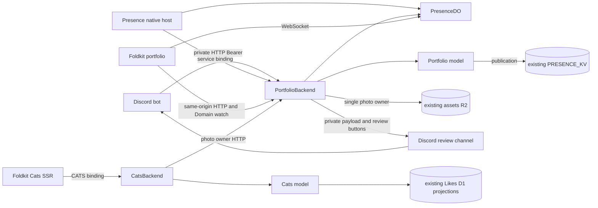

# Repository guidelines

Personal portfolio at [www.artisann.dev](https://www.artisann.dev) and Cats at
[jakes.cat](https://jakes.cat). The owner-only Discord bot is the CMS and
presence source. Foldkit renders both sites. Portfolio is build-rendered. Cats
renders each request with the existing visitor cookie.

`README.md` is the operational source of truth for Discord, secrets, migration,
and rollout. Read it before changing either backend or the bot.

## Project overview

Bun workspace (`apps/*`, `packages/*`) with catalog-pinned dependencies.

| Path                        | Role                                                                                             |
| --------------------------- | ------------------------------------------------------------------------------------------------ |
| `apps/web`                  | Foldkit portfolio, prerendered initial HTML, hydrated browser application, native backend proxy. |
| `apps/discord`              | Private dfx bot, presence source, and authorized CMS client. Separately deployed by Coolify.     |
| `apps/jakes-cats`           | Foldkit SSR website and separate `CatsBackend` Worker.                                           |
| `packages/portfolio-domain` | Pure Portfolio content, note-decision, and shared photo-operation model.                         |
| `packages/cats-domain`      | Pure Cats hearts and comments model.                                                             |
| `packages/presence`         | Native Presence class host, separate `PortfolioBackend`, HTTP contracts, and adapters.           |
| `packages/assets`           | R2 bucket, content-addressed image manifest, upload tooling.                                     |
| `packages/ui`               | Retained React/shadcn primitives. Neither Foldkit frontend uses React.                           |

`bun run dev:web` defaults to the deployed API at
`https://presence.artisann.dev`. It starts no local Portfolio storage emulator.
`bun run dev` also starts Discord. Bot commands and authenticated photo requests
can mutate production. `bun run dev:cats` is not isolated either: its by-name R2
binding and configured Portfolio photo owner can address production resources.
Never use these defaults for mutation smoke tests.

## Architecture and data flow

Domain packages import only `effect`, `@alchemy.run/domain`, and their own
files. `decide` and `evolve` remain pure. Keep I/O, authorization, moderation,
bindings, and projections that perform I/O in server adapters.

Canonical content lives in `@artisann-port/portfolio-domain/content`.
Browser-safe HTTP contracts live in `packages/presence` and Cats
`src/contracts.ts`. Encoded documents remain plain JSON. Do not import
credentials, environment readers, or Worker-only modules into these contracts.



### HTTP and live views

Portfolio routes are defined in `packages/presence/src/http-server.ts` and
`domain-worker.ts`.

| Route                                       | Authorization and purpose                                                       |
| ------------------------------------------- | ------------------------------------------------------------------------------- |
| `GET /api/content`                          | Public `SiteContent`.                                                           |
| `GET /api/photos?tag=life\|cats&cursor=...` | Public `PhotoPage`, listed from R2.                                             |
| `GET /api/github`, `GET /api/weather`       | Public, browser-safe schemas.                                                   |
| `POST /api/notes`                           | Allowed origin, Turnstile, edge rate limit, bounded input.                      |
| `/api/domain`                               | Public `PortfolioApi`, `PublishedContent` view only.                            |
| `GET/POST /api/writer/content`              | Raw-header bearer authorization. POST also requires `x-command-id`.             |
| `GET/POST /api/writer/presence`             | Raw-header bearer authorization, native presence adapter.                       |
| `POST/DELETE /api/writer/photos`            | Raw-header bearer authorization, operation ID, bounded WebP upload or deletion. |
| `POST /api/writer/photos/reconcile`         | Owner-only photo evidence and recovery controls.                                |
| `/api/migration/*`                          | Private bearer-gated Portfolio migration controls.                              |
| `/presence`                                 | Native read-only WebSocket.                                                     |
| `/projects/<id>/og-image`                   | Public image proxy with host checks and image caching.                          |

Cats HTTP contracts are in `apps/jakes-cats/src/contracts.ts`, with routes in
`src/server/http.ts`.

- `GET /api/deck`, `GET /api/top`, and `GET /api/photo/:id` expose safe views.
- `POST /api/hearts` and `POST /api/comments` apply rate limits, photo checks,
  and fail-closed comment moderation before internal Domain commands.
- `POST /api/photos` permanently retains the existing iPhone upload contract,
  bearer token, raw or multipart format, 20 MiB file cap, and HTTP `201` result.
- `/api/domain` exposes only the `PhotoCounts` view, keyed by managed photo key.
- `/api/migration/*` requires the shared writer bearer token.

Reuse `jc_visitor`. Never expose visitor IDs or raw aggregate state in public
responses. Public Domain APIs expose no mutation commands. Internal commands
must remain inaccessible through public API selection.

Old `/rpc`, `/rpc/writer`, `/rpc/notes`, Atom RPC clients, and TanStack server
functions are removed. Migrate callers instead of adding aliases or shims.
Pre-cutover tabs can require a refresh.

### Authority and storage

- Portfolio owns content, note decisions, and shared photo operations.
  `PublishedContent`, keyed `site-content`, contains only content and revision.
  KV remains a publication projection. Publication uncertainty returns `503`.
- Native `PresenceDO` owns the transient snapshot and hibernatable sockets. Keep
  its class, object IDs, and storage unchanged. Presence becomes stale after 150
  seconds. The browser retains the last song on failure.
- R2 is authoritative for photo existence. Domain records workflow metadata, not
  image bytes or a replacement photo catalog. Both Discord and Cats mutate
  photos through the single Portfolio owner.
- Cats owns hearts and comments. Its adapters use source D1 tables before
  handoff and Domain after handoff. Preserve original visitor IDs, comment IDs,
  timestamps, and heart uniqueness.
- Pending and rejected NOTE text stays only in the private Discord review
  payload. Domain may retain decision IDs, never raw unapproved text. Preserve
  existing review buttons and custom-id grammars.
- GitHub retains its `*/15` native cron, `PORT_GITHUB_TOKEN`, and KV cache.
  Weather and OG previews remain specialized adapters.

### Online migration

Production has not been deployed or migrated in this session. A code change,
local check, or plan never authorizes production actions.

Use the procedures and request schemas in `README.md`. Both models require
source change capture before baseline import, stable import identities,
catch-up, convergence checks, and a fenced single-writer handoff. Do not plan a
write shutdown. Brief retryable handoff failures are acceptable. Never report an
uncertain result as success or inflate hearts by replay.

Portfolio can be abandoned while source mode remains `legacy`, before invoking
handoff. Its handoff drains publication and fences internally. It has no
separate HTTP fence or abort route. Once fenced, recover forward, including
failed activation or an uncertain response. Cats supports abort before Domain
handoff. After handoff, never restore source authority or reverse-import new
writes. Do not reset databases, destroy resources, or rename namespaces as an
upgrade shortcut. Keep exports, status payloads, visitor IDs, and private
decisions outside public files and logs. Counts cannot replace exact convergence
checks.

Photo recovery uses `PhotoReconciliationRequest` in `photos-service.ts`. Before
`resume`, `abort`, or `confirm-deleted`, confirm that the original invocation
AND all outstanding R2 calls have stopped. Elapsed time, an HTTP timeout, or
current object absence does not prove either condition. The literal confirmation
is an operator assertion, not a platform check. Native R2 cannot fence an
external replacement between `head` and `delete`. Keep that platform limit
explicit.

### Deployment identities

- `alchemy.run.ts` keeps `ArtisannPortfolio` and `Website`, the portfolio domain
  `www.artisann.dev`, and the apex-to-www redirect. The native `PORTFOLIO`
  service binding resolves `PortfolioBackend` from `ArtisannPortfolioPresence`
  at the same stage. Browser code receives no secret.
- `packages/presence/alchemy.run.ts` keeps `ArtisannPortfolioPresence`, raw
  native Worker `Presence`, `ContentWriter`, `PresenceDO`, and KV `Snapshots`.
  Separate `PortfolioBackend` hosts Domain and adapters. The public origin stays
  `presence.artisann.dev`.
- `apps/jakes-cats/alchemy.run.ts` keeps `JakesCats`, `Website`, `Likes`,
  physical D1 name `jakes-cats-likes`, and existing migrations. `CatsBackend` is
  separate. Domains remain `jakes.cat` and `www.jakes.cat`.
- `packages/assets/alchemy.run.ts` owns the existing assets bucket and domain.
  Other stacks bind the bucket by name. They must not provision its lifecycle.
- `stacks/github.ts` owns repository settings, the zone-scoped deployment token,
  and workflow secrets. Re-running the separately approved
  `bun run deploy:github` applies stored secret or policy changes.

Coolify deploys the bot separately. Root `deploy` does not deploy the bot or run
either migration. Never append `--help` or `--dry-run` to root `deploy`. Use the
stack-specific scripts for approved previews.

## Key directories

| Path                              | Purpose                                                                                         |
| --------------------------------- | ----------------------------------------------------------------------------------------------- |
| `apps/web/src`                    | Foldkit `main.ts`, `view.ts`, entries, prerendering, Worker proxy, and preserved UI components. |
| `apps/web/src/lib`                | Typed HTTP client, native presence stream, build-time content, shuffle helpers.                 |
| `apps/discord/src`                | Bot configuration, commands, CMS, notes, photos, presence, and HTTP clients.                    |
| `apps/jakes-cats/src`             | Foldkit `App.ts`, views, entries, request renderer, API client, and browser-safe contracts.     |
| `apps/jakes-cats/src/server`      | Effect services, HTTP routes, migration, storage projections, and backend Worker.               |
| `packages/portfolio-domain/src`   | Pure Portfolio model, content schema, public API, content, notes, and photo operations.         |
| `packages/cats-domain/src`        | Pure Cats model, public counts API, and privileged internal commands.                           |
| `packages/presence/src`           | Browser-safe contracts, native class host, PortfolioBackend, services, and migration adapters.  |
| `packages/assets`                 | Manifest, `images/`, and R2 upload scripts.                                                     |
| `packages/ui`                     | Retained shadcn primitives and `cn`.                                                            |
| `tools/oxlint/{effect,anti-slop}` | Local oxlint plugins. Do not lint this tree.                                                    |
| `stacks`                          | Alchemy stacks outside the main deploy graph.                                                   |

## Development commands

Run from the repository root with Bun `1.4.2`.

```sh
bun install                         # lefthook and effect-tsgo patch
bun run dev:web                     # portfolio Vite; default proxy is live
bun run dev:cats                    # Alchemy dev; photo resources can be live
bun run dev                         # portfolio plus Discord; not safe verification
bun run discord                     # bot using .env.discord
bun run check                       # vp check; no Astro checker
bun run lint                        # vp lint
bun run format                      # vp fmt
bun run test                        # vp test, single run
bun run test --run path/to/file.ts  # scoped, from root
bun run build                       # recursive workspace builds
```

Production commands require explicit separate approval.

```sh
bun run deploy:presence --yes        # native host and PortfolioBackend, prod
bun run deploy:website --yes         # Foldkit portfolio, prod
bun run deploy:cats --yes            # CatsBackend and Foldkit website, prod
bun run deploy --yes                # the three stacks, not migration or bot
bun run plan                        # root portfolio stack plan
bun run login                       # GitHub admin profile configuration
bun run deploy:github               # admin bootstrap and stored secrets
```

`packages/presence`'s own `deploy` script does not specify `--stage prod`. Use
the root production script. Cats' package `deploy` pins `--stage prod`. Never
run `destroy` as an upgrade step.

Asset operations are unchanged. `upload` mutates the configured bucket.

```sh
bun run --cwd packages/assets generate
bun run --cwd packages/assets verify
bun run --cwd packages/assets upload:plan
bun run --cwd packages/assets upload
```

Safe local verification does not start Discord or mutate remote storage. Builds
can read the configured Portfolio API. Use isolated configuration for mutation
tests. These are commands to run, not claims that they passed.

```sh
bun run test --run
bun run check
bun run --cwd apps/discord build
bun run --cwd apps/web build
bun run --cwd apps/jakes-cats build
docker build -f apps/discord/Dockerfile -t artisann-discord .
docker compose -f apps/discord/compose.yaml config --quiet
```

## Code conventions and common patterns

### Format and lint

Config lives only in `vite.config.ts`. No Prettier, ESLint, or EditorConfig.

- 100 columns, 4-space indent, semicolons, double quotes.
- Markdown: 80 columns, `proseWrap: always`.
- Type-aware oxlint (`@effect/tsgo/oxlint-presets` plus
  `tools/oxlint/{anti-slop,effect}`).
- Type assertions need a `// SAFETY:` comment.
- Relative imports keep the `.ts` / `.tsx` extension.

Rules that reject otherwise-reasonable code: `no-direct-fetch`,
`no-module-mocking`, `no-unknown-parameters` / `-returns` / `-type-aliases`,
`no-runtime-typeof`, `no-nested-layer-provide`, `no-cascading-layer-provide`,
`no-silent-error-swallow`, `no-service-option`, `prefer-effect-match`,
`prefer-option-from-nullable`.

Do not add lint or type-check suppressions to hide errors. Foldkit updates and
subscriptions use typed Effect commands and application resources.

### Naming

- Files: kebab-case. Suffixes: `*-service.ts` (Effect service + `Live` layer),
  `*-object.ts` (DO controller), `*-client.ts` (HTTP client), `*-schema.ts`,
  `config.ts` (browser-safe constants), `*.gen.ts` (**generated, never edit**).
- Layers: `PresenceLive`, `BotConfigLive`. Bindings/config: `*Binding`,
  `*Config`.
- Schema twin:
  `export const X = Schema.Struct({...}); export type X = typeof X.Type;`
- Caps: `MAX_*`, `SCREAMING_SNAKE_CASE`.

### Effect, errors, async

Effect **4.1.4**. Use Effect 4 paths such as `effect/http/*` and
`effect/socket/*`. Do not use Effect 3 paths.

- Named functions: `Effect.fn("Name")`. Service methods: `Effect.withSpan`.
- No `fetch`. Use `HttpClient` / `FetchHttpClient.layer`.
- Domain errors are `Schema.TaggedError` (`api-errors.ts` and local siblings).
  Never leak a cause across HTTP or Domain APIs. Sanitize logs and Discord
  responses before they leave the server.
- Untrusted input decodes to a typed outcome, never a throw. `.check`-filtered
  `Schema.decodeUnknownEffect` / `decodeEffect` fail in the Effect channel,
  `Schema.decodeUnknownOption` returns `Option.none()`, and wrappers such as
  `decodeNotePayload` return `null`. Synchronous decoders can throw.
- Corrupt persisted data **fails the read**. It does not fall back to defaults.
- Bound concurrency with `Semaphore`. Timeouts at every I/O edge (bot HTTP 15s,
  interaction jobs 120s).
- Supervise long fibers: log the cause, retry on a bounded cadence.

### Dependency injection

Capabilities are Layers. Domain logic is a service that requires them. One
composition root provides everything.

- Portfolio: `PortfolioLive` in `portfolio-runtime.ts` combines the model,
  Domain storage, and adapter layers for `domain-worker.ts`.
- Cats: `CatsLive` in `server/worker.ts` and `makeServerLayer(env)` in
  `server/layer.ts` provide the model and native capabilities.
- Bot: `runtimeLayer(options)` in `apps/discord/src/main.ts` — one flat named
  graph with injectable overrides.
- Bindings are structural (`PhotosR2Binding`, `DurableObjectStorageLike`) so
  domain code does not import `@cloudflare/workers-types`.

### State

- **Authority:** Portfolio owns content after handoff. `ContentWriter` remains
  the fenced migration source. `PresenceDO` keeps native presence. Cats owns
  hearts and comments after its independent handoff. KV and D1 are projections.
- **Bot:** in-process `Ref` behind a semaphore; 2s flush, 60s confirmation.
- **Browser:** Foldkit application resources own typed clients. Domain view
  subscriptions and native presence streams follow application scope. Server
  rendering must not acquire browser sockets or run browser commands.

### Load-bearing patterns

1. **One writer per resource.** Single-writer for the bot is operational, not
   Compose-enforced. Check `docker ps` / `pgrep -f discord` before start.
2. **Deferred Discord interactions.** ACK within 3s. Authorize → validate →
   `queueJob` → return deferred. `makePostHandler` forks into the app scope
   **after** ACK. Never fork long work inside a handler (`interaction-jobs.ts`).
3. **Read-then-change-function.** `BotContentClient.updateContent` takes
   `(current) => Result<SiteContent, …>`, re-reads first, retries `conflict`
   twice. Do not write a document from a stale read.
4. **Uncertainty is never success.** Projection lag is 503, not a silent OK.
   `reject` of an already-published id is `already-approved`.
5. **Fail closed** at the boundary: custom-id grammars (`cms:`, `photos:`,
   `notes:`), origin/host allow-lists, WebP magic bytes, streamed body caps (32
   MiB / 16 KiB / 8 KiB).
6. **Redact structurally.** `Config.Redacted`. Startup errors name the variable,
   never the value.
7. **Adding an HTTP contract.** Update browser-safe schemas, the real route,
   authorized server adapter, and owned clients together. Binary uploads belong
   only on bounded private photo routes. Never restore an old RPC transport.
8. **Both DO classes** must stay exported from `packages/presence/src/worker.ts`
   (Alchemy `main`).
9. JSON and private control responses use `Cache-Control: no-store`. Do not copy
   image cache policy onto API or migration responses.

### Web UI

Tailwind v4 utilities. Preserve `data-design-node` and `data-portfolio-section`
in `apps/web/src/view.ts`. Keep a real static Turnstile script tag in
`entry.server.ts` pointing to
`https://challenges.cloudflare.com/turnstile/v0/api.js?render=explicit`. Dynamic
injection fails with "Could not find Turnscript tag." The composer requires both
a public site key and `PUBLIC_NOTES_COMPOSER=enabled`.

Traks analytics (<https://traks.dev/docs>) loads from `entry.server.ts`. Its
queue stub and `https://analytics-collect.artisann.dev/t.js` appear only when
the build has `TRAKS_SITE_KEY`, which is public by design. CI reads it from
Actions secrets. The key accepts the registered domain, subdomains, and
localhost. Custom events use `window.traks(name, props?, value?)`.

Preserve the incumbent design, initial HTML, metadata, routes, accessibility,
loading states, and failure states. Portfolio stays prerendered. Cats stays
request-rendered with `private, no-store` HTML and `jc_visitor` propagation.
Foldkit's experimental server rendering and hydration are accepted risks, not
proof of Cloudflare runtime behavior.

## Important files

Read the contracts before changing their callers.

- `packages/portfolio-domain/src/content.ts`: canonical site document.
- `packages/portfolio-domain/src/portfolio.api.ts`: public Portfolio view API.
- `packages/cats-domain/src/cats.api.ts`: public Cats counts API.
- `packages/presence/src/schema.ts`: native presence snapshot.
- `packages/presence/src/content-writer.ts`: private authoring protocol.
- `packages/presence/src/api.ts`, `photos.ts`, `notes.ts`, `github-schema.ts`:
  browser-safe HTTP response and input schemas.
- `apps/jakes-cats/src/contracts.ts`: Cats public JSON contracts.
- `packages/presence/src/config.ts`: paths, cron, staleness, allowed hosts.

Authority and migration adapters include these files.

- `packages/presence/src/portfolio-runtime.ts`, `cms-service.ts`,
  `content-migration-service.ts`, `content-migration-source.ts`.
- `packages/presence/src/content-writer-object.ts`, `presence-object.ts`,
  `durable-objects.ts`, `worker.ts`, `domain-worker.ts`, `http-server.ts`.
- `packages/presence/src/photo-domain-service.ts`, `photos-service.ts`,
  `photo-owner-client.ts`.
- `apps/jakes-cats/src/server/worker.ts`, `http.ts`, `migration-service.ts`,
  `hearts-service.ts`, `photo-index.ts`.

Application composition starts in these files.

- `apps/discord/src/main.ts` and its typed HTTP client layers.
- `apps/web/src/main.ts`, `entry.ts`, `entry.server.ts`, `worker.ts`,
  `lib/api-client.ts`, `lib/presence-client.ts`, `lib/site-content.ts`.
- `apps/jakes-cats/src/App.ts`, `entry.ts`, `entry.server.ts`, `worker.ts`.

### Infrastructure

- `package.json`, `vite.config.ts`, `lefthook.yaml`
- `alchemy.run.ts`, `packages/presence/alchemy.run.ts`,
  `packages/assets/alchemy.run.ts`, `apps/jakes-cats/alchemy.run.ts`,
  `stacks/github.ts`

**Generated**

- `packages/assets/src/manifest.gen.ts` —
  `bun run --cwd packages/assets generate`. Root `bun run build` rewrites it.

## Runtime and tooling preferences

- **Bun 1.4.2** is the runtime and runner. Workers run on workerd. CI also
  installs Node 24 for setup only (`engines.node >= 22.12.0`).
- Never hand-symlink dependencies. `bun install` already links workspaces.
- Shared versions go in the root `catalog` block. Packages reference
  `"catalog:"`. Do not pin a second copy.
- **vite-plus (`vp`)** owns run, lint, format, and test. Do not add ESLint,
  Prettier, Vitest, or `tsc` scripts.
- `bun --no-env-file` is deliberate on `dev:web`, `discord`, and the Docker
  entrypoint. Root `.env` holds Cloudflare/GitHub credentials. The bot never
  reads the repo `.env`; it uses `.env.discord` or compose `env_file`.
- Root TypeScript is `7.0.2` with `@effect/tsgo`. Foldkit removes the Astro
  checker requirement. Do not retain a separate TS6 policy for `apps/web`.
- Alchemy core and the split Cloudflare, GitHub, and Domain packages use
  `2.0.0-beta.85`. The platform adapter is `@alchemy.run/cloudflare/Domain`, not
  a newer release's `@alchemy.run/domain/Cloudflare` path.
- `prepare` runs `effect-tsgo patch --typescript --oxlint`. Dev installs must
  not use `--ignore-scripts`. Docker/CI Discord image **does** use
  `--ignore-scripts` on purpose.
- Private registries: `.npmrc` needs `HUGE_ICONS_TOKEN` / `MOTION_TOKEN` for a
  full install. Discord Docker uses `--filter @artisann-port/discord` so those
  tokens are not required.
- `sharp` is `--external` in the bot bundle. Build the image on the target
  architecture. Do not copy macOS `node_modules`.
- Secrets are runtime-only. Never a build `ARG`/`ENV`. Do not print secret
  values or expanded compose config.
- Design files: `tools/design-files/landing.pen` is encrypted. Use Pencil MCP
  tools only. Do not `Read`/`Grep` `.pen` files.
- Long-running dev servers inside a git worktree: follow the Herdr coordination
  policy when `HERDR_ENV=1`. Install, edit, build, and test do not use Herdr.

Prod Alchemy resources and domains exist only with `--stage prod`. Use `--yes`
for non-interactive deploys. CI deploys after a successful `main` push
(`cloudflare-production` concurrency, skip superseded SHAs). There is no
`workflow_dispatch`.

## Testing and QA

Single runner: Vitest inside vite-plus. Import from `vite-plus/test`. Config is
the root `vite.config.ts` `test` block (`passWithNoTests: true`). No
`vitest.config`, no Jest, no `bun:test`, no per-package `test` script.

```sh
bun run test                                          # whole workspace
bun run test --run apps/jakes-cats/__tests__/migration-service.test.ts
bun x --no-install vp test watch                      # watch
```

Always run from the **repo root**. `bun run --cwd apps/web test` fails.
`passWithNoTests: true` exits 0 on a typo'd path — check `Test Files N passed`.

Tests live only in `__tests__/`.

- `packages/presence/__tests__/`: HTTP boundaries, native controllers, photo
  ownership and reconciliation, content migration, and schemas.
- `apps/discord/__tests__/`: commands, CMS, notes, HTTP clients, presence, and
  configuration.
- `apps/web/__tests__/`: native presence and real Foldkit server rendering.
- `apps/jakes-cats/__tests__/`: HTTP boundaries, upload authorization,
  moderation, hearts, comments, and online migration against the real Domain
  model.

Place new tests under `__tests__/`. A `src/*.test.ts` file misses the lint
override for `effecttsgo/async-function`, `global-date`, and `new-promise`.

**Fakes, not mocks.** `anti-slop/no-module-mocking` rejects `vi.mock`. Inject
complete Effect Layers (unused members `Effect.die`), scripted `HttpClient`
under real clients, or hand-written doubles such as `MemoryStorage` and
`LocalSocket`. `vi.stubGlobal` and fake timers are allowed. No sleeps: use
`Deferred` gates and `TestClock`.

Domain stories use the real model and public or privileged API appropriate to
the boundary. Use deterministic storage and external-service fakes. Test
acknowledged writes, replay, convergence, authorization, and failure recovery.
Do not replace these tests with command echoes or module mocks. Web rendering
tests use `foldkit/experimental/server`, not React or Atom SSR. No jsdom or
Testing Library.

No coverage thresholds. Pre-commit formats and lints only. CI: `check` → `test`
→ `build`.

Local tests and browser checks do not prove live Discord, Turnstile, Cloudflare
hibernation, deployed bindings, or production convergence. Use isolated KV, R2,
D1, and model storage for mutation checks. Never mutate live storage as a smoke
test. Assets use `verify` for manifest checks.

Read before changing the matching area:

- `apps/jakes-cats/__tests__/migration-service.test.ts`
- `apps/discord/__tests__/content-client.test.ts`
- `apps/discord/__tests__/notes.test.ts`
- `packages/presence/__tests__/content-writer-object.test.ts`
- `apps/web/__tests__/presence-client.test.ts`
